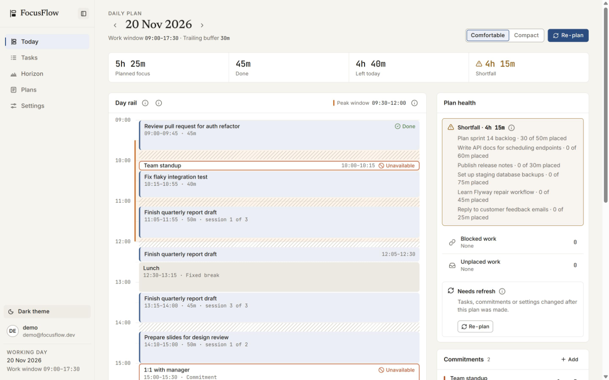
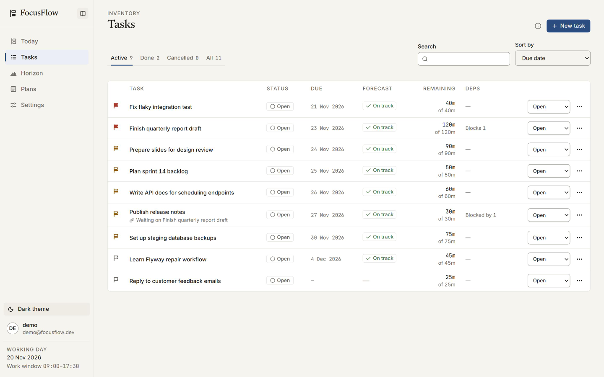
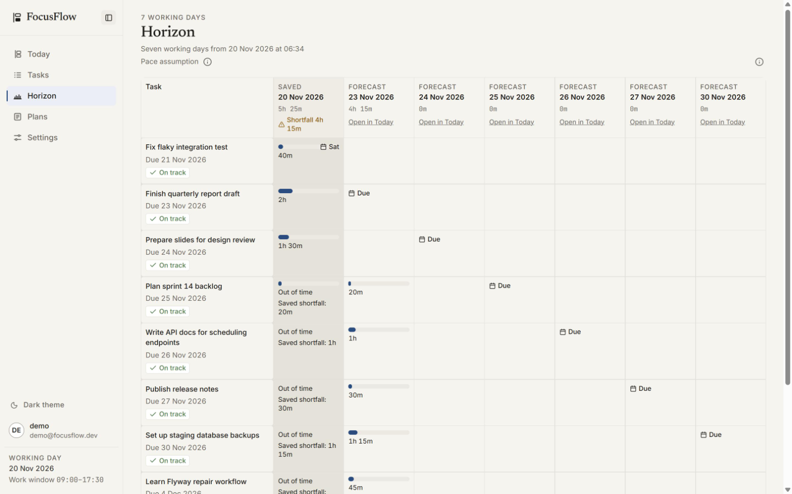
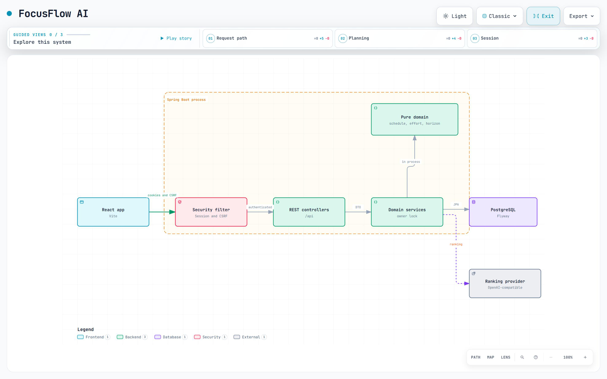

# FocusFlow AI

> Turn your task list into a realistic, clock-based plan for the day — ranked by AI, scheduled by deterministic Java.


FocusFlow AI is a Java-first full-stack app. A Spring Boot backend manages tasks and AI-assisted daily plans; a React/Vite frontend provides the browser experience. The AI only **ranks** your tasks. A pure-Java scheduler then places them on a real clock, respecting your work window, breaks, commitments, and dependencies.

## Screenshots

| Today's scheduled day | Task inventory |
|---|---|
|  |  |

| Multi-day horizon forecast | Architecture |
|---|---|
|  |  |

## Features

- **AI-ranked, Java-scheduled days** — the model returns one ordered list of task ids; deterministic code places work into minute-aligned blocks and validates the result.
- **Rest-aware scheduling** — focus cadence, fixed breaks, commitments, and a trailing buffer.
- **Progress and carry-over** — record done / partly done / skipped outcomes, reassess remaining effort, and re-plan while preserving schedule revisions.
- **Task dependencies** — finish-to-start links with inherited urgency and automatic order repair.
- **Seven-working-day horizon** — a read-only forecast marking work on track, at risk, overdue, or beyond the horizon.
- **Session auth with CSRF** — HttpOnly session cookie, per-user data isolation, request-id correlation.
- **Provider-agnostic AI** — any OpenAI-compatible endpoint (OpenAI, DeepSeek, ...).
- **Documented API** — hand-written [API guide](docs/api.md) plus a generated OpenAPI contract.

## Tech stack

| Layer | Technology |
|---|---|
| Backend | Java 21, Spring Boot 3.4, Spring Security, Spring Data JPA, Flyway |
| Database | PostgreSQL 16 via Docker Compose |
| Frontend | React 19, TypeScript, Vite, Tailwind CSS 4, TanStack Query, React Hook Form, Zod |
| AI | OpenAI-compatible chat API |
| Testing | JUnit 5, Testcontainers, Vitest, Testing Library |
| CI | GitHub Actions (backend and frontend workflows) |

## Prerequisites

- Java 21 (JDK)
- Docker Desktop (for local PostgreSQL)
- Node.js LTS and npm (for the React frontend)
- Git

The Gradle wrapper is included, so a global Gradle installation is not required. The backend targets Java 21. On Gradle 9, the included Foojay toolchain resolver can provision Java 21 when it is not installed locally.


## Quick start

1. Clone the repository, then copy the environment template at the repository root:

   ```powershell
   copy .env.example .env
   ```

2. Start PostgreSQL:

   ```powershell
   docker compose up -d
   ```

3. Set AI provider variables in `.env` if you want live plan generation. They are optional for registration, login, and task CRUD:

   ```env
   OPENAI_API_KEY=your-provider-key
   OPENAI_MODEL=gpt-4.1-mini
   OPENAI_BASE_URL=https://api.openai.com/v1
   ```

   For DeepSeek (OpenAI-compatible):

   ```env
   OPENAI_API_KEY=your-deepseek-key
   OPENAI_MODEL=deepseek-chat
   OPENAI_BASE_URL=https://api.deepseek.com/v1
   ```

   `.\gradlew.bat bootRun` loads the repo-root `.env` into the Spring process automatically. You do not need `echo $env:OPENAI_*` to show values in your shell; restart `bootRun` after editing `.env`. Shell or CI environment variables still take precedence when set.

4. Run the backend in one terminal. Flyway applies the database migrations automatically at startup.

   ```powershell
   cd backend
   .\gradlew.bat bootRun
   ```

   API base URL: `http://localhost:8080`

   **Optional — Swagger UI (dev profile only):**

   ```powershell
   cd backend
   .\gradlew.bat bootRun --args="--spring.profiles.active=dev"
   ```

   Then open `http://localhost:8080/swagger-ui/index.html`. OpenAPI JSON is at `/v3/api-docs`. Without the `dev` profile, those paths are not exposed.


5. In a second terminal, install frontend dependencies once and start Vite:

   ```powershell
   cd frontend
   npm install
   npm run dev
   ```

   Open `http://localhost:5173`. During development, Vite proxies `/api` requests to the Spring backend at `http://localhost:8080`; use port 5173 for browser and cookie-aware HTTP checks.

## Environment variables

| Variable | Purpose | Default |
|----------|---------|---------|
| `POSTGRES_DB` | Docker Postgres database name | `focusflow` |
| `POSTGRES_USER` | Docker Postgres user | `focusflow` |
| `POSTGRES_PASSWORD` | Docker Postgres password | `focusflow` |
| `POSTGRES_PORT` | Host port for Postgres | `5432` |
| `SPRING_DATASOURCE_URL` | JDBC URL for Spring Boot | `jdbc:postgresql://127.0.0.1:5432/focusflow` |
| `SPRING_DATASOURCE_USERNAME` | DB username | `focusflow` |
| `SPRING_DATASOURCE_PASSWORD` | DB password | `focusflow` |
| `OPENAI_API_KEY` | Provider API key | empty |
| `OPENAI_MODEL` | Model id sent to provider | `gpt-4.1-mini` |
| `OPENAI_BASE_URL` | OpenAI-compatible API base URL | `https://api.openai.com/v1` |

Do not commit `.env`. Use `.env.example` as the template. Docker Compose and `bootRun` both read the repo-root `.env`; database settings also have matching defaults in `application.yml` when those variables are unset.


## Test and build commands

Run these from separate terminals as needed:

```powershell
# Backend: Testcontainers requires Docker Desktop to be running.
cd backend
.\gradlew.bat test

# Frontend production build
cd frontend
npm run build

# Optional frontend test suite
npm run test:run

# Regenerate committed OpenAPI snapshot after intentional API changes
cd backend
.\gradlew.bat updateOpenApiSnapshot
```

## Documentation

- [API reference](docs/api.md) — session/CSRF calling rules, request/response schemas, status codes
- [OpenAPI](docs/openapi.yaml) — generated machine-readable contract (OpenAPI 3); refresh with `.\gradlew.bat updateOpenApiSnapshot` in `backend/`
- [Architecture](docs/architecture.md) — system overview, backend components, request and generate flows, data model
- [Domain glossary](CONTEXT.md) — canonical FocusFlow planning and task language
- [Schema adoption decision](docs/adr/0001-explicit-legacy-schema-adoption.md) — why legacy Flyway adoption is explicit rather than automatic
- [Roadmap](docs/superpowers/roadmap.md) — in-progress and upcoming milestones, settled cross-milestone decisions, deferred backlog

## Project layout

```
backend/             Spring Boot application and JUnit tests
frontend/            React, TypeScript, Vite application and Vitest tests
docker-compose.yml   Local PostgreSQL service
.env.example         Local database and OpenAI-compatible provider template
docs/                API reference, OpenAPI, architecture, design notes, and plans
  api.md             Human-readable API calling guide
  openapi.yaml       Generated OpenAPI contract (refresh via updateOpenApiSnapshot)
  architecture.md    System architecture, components, and learning map
  design/            Approved frontend design contract (local prototype is gitignored)
```

## Contributing

Issues and pull requests are welcome.

1. Fork the repo and create a feature branch.
2. Keep behavior changes covered by tests (`.\gradlew.bat test`, `npm run test:run`).
3. Make sure `npm run lint`, `npm run typecheck`, and the backend tests pass — CI runs the same checks.
4. Use [Conventional Commits](https://www.conventionalcommits.org/) for commit messages (e.g. `fix(frontend): ...`).
5. Open a pull request describing the change and how you verified it.

## Acknowledgements

Built as a Java-first learning project. Domain language lives in the [glossary](CONTEXT.md); design decisions are recorded as ADRs under [`docs/adr/`](docs/adr/).
