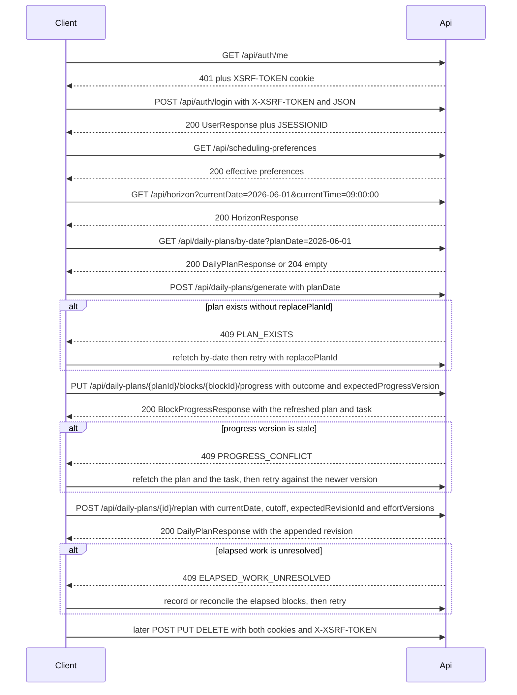

# FocusFlow AI — API Reference

Back to [README](../README.md). Machine-readable contract: [openapi.yaml](openapi.yaml) (generated from code; see README for the update command).

## Base URLs

| Environment | Base URL | Notes |
|-------------|----------|-------|
| Backend | `http://localhost:8080` | Direct Spring Boot |
| Vite dev proxy | `http://localhost:5173` | Prefer for browser and cookie-aware HTTP clients; `/api` is proxied to `:8080` |

All paths below are relative to the base URL (e.g. `POST http://localhost:5173/api/auth/login`).

## Shared calling rules

### Content type

Request bodies use `Content-Type: application/json`.

### Authentication

| Route class | Endpoints | Requirement |
|-------------|-----------|-------------|
| Public (no session) | `POST /api/auth/register`, `POST /api/auth/login` | No `JSESSIONID` required |
| Session | All other routes | Valid `JSESSIONID` session cookie |

Register and login both authenticate the user and start a session (`JSESSIONID`, HttpOnly).

### CSRF

State-changing requests (`POST`, `PUT`, `DELETE`) require:

- Cookie: `XSRF-TOKEN` (readable, not HttpOnly)
- Header: `X-XSRF-TOKEN: <same value as cookie>`

This applies to public register/login as well as authenticated mutations.

**Seed the CSRF token:** send `GET /api/auth/me` (or any request that hits the CSRF filter). When logged out, **401** is expected; the response still sets `XSRF-TOKEN`.

### Request correlation

Every response includes `X-Request-Id`. Clients may send the same header on the request; if absent or invalid, the server generates a UUID. The value appears in server logs and, for application errors that use `ApiErrorResponse`, in the JSON `requestId` field.

Unauthenticated **401** and CSRF **403** responses include the header but keep their existing minimal bodies.

### Health probes (orchestration)

| Endpoint | Auth | Notes |
|----------|------|-------|
| `GET /actuator/health/liveness` | Public | Process up; no component details |
| `GET /actuator/health/readiness` | Public | Includes PostgreSQL; no component details |
| `GET /actuator/health` | Session | Aggregate health (details hidden) |
| `GET /actuator/metrics` | Session | Micrometer metrics |

Swagger UI and `/v3/api-docs` are available only under the Spring **`dev`** profile (see README).

### Unauthenticated and CSRF failures

| Condition | Status | Body |
|-----------|--------|------|
| Protected route, no session | **401** | Minimal/empty (Spring authentication entry point; not always `ApiErrorResponse`) |
| Missing or invalid CSRF on mutation | **403** | Spring Security CSRF rejection |

### Success status codes

| Code | Usage |
|------|-------|
| **200** | OK with JSON body |
| **201** | Created with JSON body |
| **204** | Success, no body |

## Error response (`ApiErrorResponse`)

Most application errors return:

```json
{
  "timestamp": "2026-06-01T12:00:00Z",
  "status": 409,
  "error": "Conflict",
  "message": "plan already exists",
  "code": "PLAN_EXISTS",
  "path": "/api/daily-plans/generate",
  "details": {
    "title": ["must not be blank"]
  },
  "requestId": "a1b2c3d4-e5f6-7890-abcd-ef1234567890"
}
```

| Field | Type | Notes |
|-------|------|-------|
| `timestamp` | string (ISO-8601 instant) | Present on handler-generated errors |
| `status` | integer | HTTP status |
| `error` | string | Reason phrase (e.g. `Bad Request`) |
| `message` | string | Human-readable message |
| `code` | string \| null | Optional stable machine-readable code; omitted when null |
| `path` | string | Request path |
| `details` | object → string[] | Optional; field validation errors only |
| `requestId` | string | Optional; correlation id when present in MDC |

Omitted null fields are excluded from JSON (`@JsonInclude(NON_NULL)`).

### Stable error codes

Clients should branch on `code`, not `message` copy.

| Code | Typical status | When |
|------|----------------|------|
| `PLAN_EXISTS` | **409** | A plan already exists for `planDate` and `replacePlanId` was omitted |
| `PLAN_CHANGED` | **409** | `replacePlanId` is stale (another plan is now latest for that date, or no plan exists); also a re-plan whose `expectedRevisionId` or `effortVersions` no longer match the server |
| `TASK_MISSING_DURING_GENERATION` | **409** | A ranked task disappeared between the AI call and the transactional save |
| `PLAN_CANDIDATE_LIMIT` | **400** | More than 100 plannable tasks (`OPEN` + `IN_PROGRESS`) |
| `PLAN_HAS_PROGRESS` | **409** | Generate or delete was asked for a plan that has at least one recorded block outcome. An unrecorded no-longer-needed session does not count |
| `PROGRESS_CONFLICT` | **409** | `expectedProgressVersion` or `effortVersion` is behind the server. Refetch, then retry against the newer version |
| `REMAINDER_UNRESOLVED` | **400** | The credit would exhaust the task's remaining effort without a `finish` or a positive `checkpoint` in the same save |
| `FUTURE_ACTUAL` | **400** | The work date is after the client-supplied current date |
| `BLOCK_NOT_RECORDABLE` | **400** | The block is superseded, or it is an unused session of a finished or cancelled task |
| `ELAPSED_WORK_UNRESOLVED` | **409** | Re-plan was asked while an elapsed block has no outcome, or a block that spans the cutoff is unreconciled |
| `REPLAN_LEGACY_SNAPSHOT` | **409** | The plan has no complete scheduling snapshot (migrated from before revisions) |
| `REPLAN_NOT_TODAY` | **409** | The plan date is not the client-supplied current date |
| `REPLAN_WINDOW_ENDED` | **409** | The cutoff is at or after the original window end |
| `SELF_DEPENDENCY` | **400** | `blockerTaskId` is the same task |
| `DEPENDENCY_EXISTS` | **409** | That blocker/blocked pair already exists |
| `DEPENDENCY_CYCLE` | **409** | The new link would close a cycle, including through a Done or Cancelled task |

Invalid AI ranking returns **502** with `code` null. The server records bounded rejection reasons (`UNKNOWN_TASK`, `DUPLICATE_TASK`, `BLOCK_ORDER`, `MISSING_BLOCK_1`, `MISSING_BLOCK_2`, `MISSING_OPTIONAL`) in Micrometer only.

## Shared schemas

### `PageResponse<T>`

| Field | Type | Required |
|-------|------|----------|
| `content` | array | yes |
| `page` | integer | yes | Zero-based page index |
| `size` | integer | yes | Page size |
| `totalElements` | integer | yes | Total matching rows |
| `totalPages` | integer | yes | Total pages |

### Enums

| Name | Values |
|------|--------|
| `TaskPriority` | `LOW`, `MEDIUM`, `HIGH` |
| `TaskStatus` | `OPEN`, `IN_PROGRESS`, `DONE`, `CANCELLED` |
| `BlockKind` | `WORK`, `CADENCE_BREAK`, `FIXED_BREAK`, `COMMITMENT`, `BUFFER` |
| `UnplacedReason` | `NO_ESTIMATE`, `OUT_OF_TIME`, `BLOCKED` |
| `WorkOutcome` | `DONE`, `PARTLY_DONE`, `SKIPPED` |
| `BlockDisplayState` | `ACTIONABLE`, `HISTORICAL`, `SUPERSEDED`, `NO_LONGER_NEEDED` |
| `DayOfWeek` | `MONDAY`, `TUESDAY`, `WEDNESDAY`, `THURSDAY`, `FRIDAY`, `SATURDAY`, `SUNDAY` |
| `HorizonDayKind` | `SAVED`, `FORECAST` |
| `DeadlineStatus` | `OVERDUE`, `CANNOT_FORECAST`, `ON_TRACK`, `AT_RISK`, `BEYOND_HORIZON` |
| `CreditExclusion` | `DEPENDENCY`, `CHECKPOINT` |
| `UnplacedScope` | `SAVED_SHORTFALL`, `FORECAST` |

### `UserResponse`

| Field | Type | Required |
|-------|------|----------|
| `id` | integer | yes |
| `email` | string | yes |
| `username` | string | yes |

### `TaskResponse`

| Field | Type | Required | Notes |
|-------|------|----------|-------|
| `id` | integer | yes | |
| `title` | string | yes | |
| `description` | string \| null | yes | |
| `priority` | `TaskPriority` | yes | |
| `status` | `TaskStatus` | yes | |
| `dueDate` | string (date) \| null | yes | `YYYY-MM-DD` |
| `estimatedMinutes` | integer \| null | yes | Null or positive. Whole-task estimate |
| `remainingEffortMinutes` | integer \| null | yes | Current estimate of time still needed; null means unknown |
| `effortVersion` | integer | yes | Monotonic; send back as `effortVersion` on progress writes |
| `blockedBy` | `TaskLinkResponse[]` | yes | Tasks that block this one, ordered by `taskId`. Empty when none |
| `blocks` | `TaskLinkResponse[]` | yes | Tasks this one blocks, ordered by `taskId`. Empty when none |

### `TaskLinkResponse`

One end of a finish-to-start link.

| Field | Type | Required | Notes |
|-------|------|----------|-------|
| `taskId` | integer | yes | The other task |
| `title` | string | yes | |
| `status` | `TaskStatus` | yes | |

### `TaskSnapshotResponse`

Frozen task fields captured at plan generation. Work blocks reference this snapshot, not live task rows.

| Field | Type | Required | Notes |
|-------|------|----------|-------|
| `sourceTaskId` | integer | yes | Original task id |
| `taskReferenceId` | integer \| null | yes | Live task id when still linked |
| `title` | string | yes | |
| `priority` | `TaskPriority` | yes | |
| `status` | `TaskStatus` | yes | Status at generate time |
| `dueDate` | string (date) \| null | yes | |
| `estimatedMinutes` | integer \| null | yes | |
| `capturedRemainingEffortMinutes` | integer \| null | yes | Remaining effort this revision scheduled; null when unknown |
| `mustInclude` | boolean | yes | Captured inherited group is not optional: in progress, due on or before the plan date, or a blocker that inherits that urgency |
| `capturedCheckpointId` | integer \| null | yes | Latest remaining-effort checkpoint id captured with this revision; null when none |
| `neededForTaskId` | integer \| null | yes | Task whose urgency this snapshot inherited; null when the task's own group applies |

### `ScheduledBlockResponse`

One minute-aligned interval on a revision rail.

| Field | Type | Required | Notes |
|-------|------|----------|-------|
| `kind` | `BlockKind` | yes | |
| `startTime` | string (time) | yes | `HH:mm:ss` |
| `endTime` | string (time) | yes | |
| `sessionIndex` | integer \| null | yes | 1-based work session for this task; null for non-work blocks |
| `sessionCount` | integer \| null | yes | Total work sessions for this task; null for non-work blocks |
| `taskSnapshot` | `TaskSnapshotResponse` \| null | yes | Populated for `WORK` blocks |
| `label` | string \| null | yes | Fixed-break or commitment label when applicable |
| `id` | integer \| null | yes | Block id; null for a derived composed-rail entry that has no stored row |
| `revisionId` | integer \| null | yes | Revision the block belongs to |
| `outcome` | `WorkOutcome` \| null | yes | Recorded outcome; null while unrecorded |
| `actualMinutes` | integer \| null | yes | Time spent; null means not recorded (not zero) |
| `reconciled` | boolean | yes | Crossing block closed at the re-plan cutoff with a checkpoint |
| `progressVersion` | integer | yes | Send back as `expectedProgressVersion` on the next write |
| `displayState` | `BlockDisplayState` | yes | Only `ACTIONABLE` and `HISTORICAL` accept a new outcome |

### `UnplacedWorkResponse`

Ranked task that could not be fully scheduled.

| Field | Type | Required | Notes |
|-------|------|----------|-------|
| `reason` | `UnplacedReason` | yes | `BLOCKED` means an active blocker was not fully placed |
| `unplacedMinutes` | integer \| null | yes | Minutes that did not fit when `OUT_OF_TIME` or `BLOCKED` |
| `taskSnapshot` | `TaskSnapshotResponse` | yes | |
| `blockerSourceTaskIds` | integer[] | yes | Direct blockers from this revision's dependency snapshot when `reason` is `BLOCKED`; otherwise empty |

### `DailyPlanWarning`

Derived on read when must-include snapshots have unplaced work. Not persisted as a separate column.

| Field | Type | Required |
|-------|------|----------|
| `requiredMinutes` | integer | yes |
| `freeMinutes` | integer | yes |
| `scheduledWorkMinutes` | integer | yes |
| `outOfTimeTasks` | array | yes |
| `unestimatedTasks` | array | yes |
| `blockedTasks` | array | yes |

`outOfTimeTasks[]`: `{ "sourceTaskId": number, "title": string, "unplacedMinutes": number }`

`unestimatedTasks[]`: `{ "sourceTaskId": number, "title": string }`

`blockedTasks[]`: `{ "sourceTaskId": number, "title": string, "blockerSourceTaskIds": number[] }` — must-include snapshots unplaced as `BLOCKED`, with blocker ids from that revision's dependency snapshot.

### `DailyPlanResponse`

Full scheduled-day detail. Schedule metrics and `blocks` are read from the plan's **latest revision**; `revisions` exposes all of them.

| Field | Type | Required | Notes |
|-------|------|----------|-------|
| `id` | integer | yes | |
| `planDate` | string (date) | yes | `YYYY-MM-DD` |
| `createdAt` | string (instant) | yes | ISO-8601 |
| `windowStart` | string (time) | yes | Effective work window start |
| `windowEnd` | string (time) | yes | Effective work window end |
| `peakStart` | string (time) \| null | yes | Visual peak band; null when unset |
| `peakEnd` | string (time) \| null | yes | |
| `freeMinutes` | integer | yes | Minutes still free after scheduling |
| `scheduledWorkMinutes` | integer | yes | Work placed on the rail |
| `requiredMinutes` | integer | yes | Captured remaining effort considered |
| `requestedBufferMinutes` | integer | yes | Buffer requested from preferences |
| `realizedBufferMinutes` | integer | yes | Buffer actually reserved at end of window |
| `warning` | `DailyPlanWarning` \| null | yes | Derived shortfall; null when no must-include gap |
| `blocks` | `ScheduledBlockResponse[]` | yes | Ordered rail of the latest revision |
| `unplacedWork` | `UnplacedWorkResponse[]` | yes | Companion list for unscheduled ranked tasks |
| `needsRefresh` | boolean | yes | Captured remaining effort or plannability no longer matches the live tasks |
| `knownActualMinutes` | integer | yes | Day-wide sum of recorded actual minutes; each known actual counts once |
| `missingActualCount` | integer | yes | Work blocks completed without recorded minutes |
| `revisions` | `PlanRevisionResponse[]` | yes | Every revision, oldest first |
| `composedRail` | `ScheduledBlockResponse[]` | yes | Non-overlapping rail: elapsed history through the latest cutoff plus the latest revision from the cutoff forward |
| `offRailEarlyCompletions` | `ScheduledBlockResponse[]` | yes | Early completions whose whole interval falls after the latest cutoff |
| `unplannedWork` | `UnplannedWorkResponse[]` | yes | Dated unplanned work credited to this plan date |

List-by-id, generate, by-date, and re-plan return this shape.

### `DailyPlanSummaryResponse`

History list rows only — no blocks or snapshots.

| Field | Type | Required | Notes |
|-------|------|----------|-------|
| `id` | integer | yes | |
| `planDate` | string (date) | yes | `YYYY-MM-DD` |
| `createdAt` | string (instant) | yes | ISO-8601 |
| `scheduledWorkMinutes` | integer | yes | |
| `workSessionCount` | integer | yes | |
| `scheduledTaskCount` | integer | yes | |
| `unplacedWorkCount` | integer | yes | |
| `hasWarning` | boolean | yes | Derived must-include shortfall present |
| `hasProgress` | boolean | yes | Any block on any revision carries a recorded outcome |
| `needsRefresh` | boolean | yes | Same condition as the detail field |

### `PlanRevisionResponse`

One schedule revision of a plan. Re-planning appends a revision to the same plan id.

| Field | Type | Required | Notes |
|-------|------|----------|-------|
| `id` | integer | yes | |
| `revisionNumber` | integer | yes | 1-based; 1 is the original generation |
| `cutoff` | string (time) \| null | yes | Re-plan cutoff that started this revision; null for the original |
| `freeMinutes` | integer | yes | |
| `scheduledWorkMinutes` | integer | yes | |
| `requiredMinutes` | integer | yes | |
| `requestedBufferMinutes` | integer | yes | |
| `realizedBufferMinutes` | integer | yes | |
| `blocks` | `ScheduledBlockResponse[]` | yes | This revision's rail |
| `unplacedWork` | `UnplacedWorkResponse[]` | yes | |

### `UnplannedWorkResponse`

Dated work credited to a task that was not on the rail.

| Field | Type | Required | Notes |
|-------|------|----------|-------|
| `id` | integer | yes | |
| `sourceTaskId` | integer | yes | Original task id; survives task deletion |
| `taskReferenceId` | integer \| null | yes | Live task id when still linked |
| `workDate` | string (date) | yes | `YYYY-MM-DD` |
| `actualMinutes` | integer | yes | Positive |
| `recordedAt` | string (instant) | yes | ISO-8601 |

### `UnplannedWorkRequest`

Body for create and correct.

| Field | Type | Required | Notes |
|-------|------|----------|-------|
| `taskId` | integer | yes | Target task |
| `workDate` | string (date) | yes | Must not be after `currentDate` |
| `actualMinutes` | integer | yes | Positive |
| `currentDate` | string (date) | yes | Client-supplied current date |
| `effortVersion` | integer | no | Expected task effort version; stale → **409** `PROGRESS_CONFLICT` |
| `finish` | boolean | no | Marks the task finished without an extra credit |
| `checkpoint` | `Checkpoint` | no | Explicit reassessment; replaces the running remainder |

### `Checkpoint`

| Field | Type | Required | Notes |
|-------|------|----------|-------|
| `remainingEffortMinutes` | integer \| null | no | Explicit unknown when null |

### `BlockProgressRequest`

Body for `PUT /api/daily-plans/{planId}/blocks/{blockId}/progress`.

| Field | Type | Required | Notes |
|-------|------|----------|-------|
| `outcome` | `WorkOutcome` | yes | `DONE`, `PARTLY_DONE`, or `SKIPPED` |
| `actualMinutes` | integer | no | Required and positive for `PARTLY_DONE`; null means not recorded |
| `currentDate` | string (date) | yes | Client-supplied current date; plan after it → **400** `FUTURE_ACTUAL` |
| `expectedProgressVersion` | integer | no | Block's `progressVersion`; stale → **409** `PROGRESS_CONFLICT` |
| `finish` | boolean | no | Finishes the task |
| `checkpoint` | `Checkpoint` | no | Explicit reassessment; replaces the running remainder |
| `cutoff` | string (time) | no | Set to the current time to reconcile a block that spans now; grants no planned credit |

### `BlockProgressResponse`

| Field | Type | Required | Notes |
|-------|------|----------|-------|
| `task` | `TaskResponse` | yes | Task after the credit |
| `plan` | `DailyPlanResponse` | yes | Plan after the credit |

### `RemainingEffortRequest`

Body for `POST /api/tasks/{id}/remaining-effort`.

| Field | Type | Required | Notes |
|-------|------|----------|-------|
| `remainingEffortMinutes` | integer | yes | Positive reassessment |
| `currentDate` | string (date) | yes | Client-supplied current date |
| `effortVersion` | integer | no | Stale → **409** `PROGRESS_CONFLICT` |

### `TaskEffortVersion`

One captured task effort version, used for re-plan freshness.

| Field | Type | Required | Notes |
|-------|------|----------|-------|
| `taskId` | integer | yes | |
| `effortVersion` | integer | yes | |

### `ReplanRequest`

Body for `POST /api/daily-plans/{id}/replan`. All fields are required.

| Field | Type | Required | Notes |
|-------|------|----------|-------|
| `currentDate` | string (date) | yes | Must equal the plan date |
| `cutoff` | string (time) | yes | Client current time; before the window start it clamps up, at or after the window end it is rejected |
| `expectedRevisionId` | integer | yes | Latest revision id the client saw; stale → **409** `PLAN_CHANGED` |
| `effortVersions` | `TaskEffortVersion[]` | yes | One entry per current plannable task, matching server state |

### `SchedulingPreferencesResponse`

Effective scheduling settings for the current user.

| Field | Type | Required | Notes |
|-------|------|----------|-------|
| `workDayStart` | string (time) | yes | |
| `workDayEnd` | string (time) | yes | |
| `cadenceEnabled` | boolean | yes | |
| `targetFocusMinutes` | integer | yes | |
| `breakMinutes` | integer | yes | |
| `minSessionMinutes` | integer | yes | |
| `bufferMinutes` | integer | yes | |
| `peakStart` | string (time) \| null | yes | Optional visual band |
| `peakEnd` | string (time) \| null | yes | |
| `fixedBreaks` | array | yes | `{ label, startTime, endTime }` |
| `workingDays` | `DayOfWeek[]` | yes | Weekdays the horizon treats as working days. In-code default is Monday through Friday |
| `persisted` | boolean | yes | `false` when serving in-code defaults only |

### `SchedulingPreferencesRequest`

Write model for `PUT /api/scheduling-preferences`. Same fields as the response except `persisted` (always written on save). All times minute-aligned.

### `CommitmentResponse`

| Field | Type | Required |
|-------|------|----------|
| `id` | integer | yes |
| `title` | string | yes |
| `commitmentDate` | string (date) | yes |
| `startTime` | string (time) | yes |
| `endTime` | string (time) | yes |

### `CommitmentRequest`

| Field | Type | Required | Validation |
|-------|------|----------|------------|
| `title` | string | yes | Not blank, max 255 |
| `commitmentDate` | string (date) | yes | `YYYY-MM-DD` |
| `startTime` | string (time) | yes | Minute-aligned; before `endTime` |
| `endTime` | string (time) | yes | Minute-aligned |

---

## Auth

### `POST /api/auth/register`

Create account and start a session.

| | |
|---|---|
| **Auth** | Public |
| **CSRF** | Required |

**Request body — `RegisterRequest`**

| Field | Type | Required | Validation |
|-------|------|----------|------------|
| `email` | string | yes | Valid email, not blank |
| `username` | string | yes | 3–30 characters, not blank |
| `password` | string | yes | Min 8 characters, not blank |

**Responses**

| Status | Body |
|--------|------|
| **201** | `UserResponse` |
| **400** | `ApiErrorResponse` — validation failed (`details` per field) |
| **409** | `ApiErrorResponse` — `message`: `email already registered` or `username already taken` |

---

### `POST /api/auth/login`

Start a session.

| | |
|---|---|
| **Auth** | Public |
| **CSRF** | Required |

**Request body — `LoginRequest`**

| Field | Type | Required |
|-------|------|----------|
| `username` | string | yes, not blank |
| `password` | string | yes, not blank |

**Responses**

| Status | Body |
|--------|------|
| **200** | `UserResponse` |
| **401** | `ApiErrorResponse` — `message`: `Invalid credentials` |

---

### `POST /api/auth/logout`

End session. Configured in Spring Security (not `AuthController`).

| | |
|---|---|
| **Auth** | Session |
| **CSRF** | Required |

**Request body:** none

**Responses**

| Status | Body |
|--------|------|
| **204** | Empty; session invalidated, `JSESSIONID` deleted |
| **401** | Not authenticated |

---

### `GET /api/auth/me`

Current user.

| | |
|---|---|
| **Auth** | Session |
| **CSRF** | Not required |

**Responses**

| Status | Body |
|--------|------|
| **200** | `UserResponse` |
| **401** | Not authenticated |

---

## Tasks

All task routes require session. Mutations require CSRF.

### `POST /api/tasks`

Create task.

**Request body — `CreateTaskRequest`**

| Field | Type | Required | Notes |
|-------|------|----------|-------|
| `title` | string | yes | Not blank |
| `description` | string | no | |
| `priority` | `TaskPriority` | no | Default `MEDIUM` |
| `dueDate` | string (date) | no | `YYYY-MM-DD` |
| `estimatedMinutes` | integer | no | Null or positive |

**Responses**

| Status | Body |
|--------|------|
| **201** | `TaskResponse` (status `OPEN`) |
| **400** | Validation failed |
| **401** | Not authenticated |

---

### `GET /api/tasks`

List current user's tasks (ordered by due date ascending).

**Responses**

| Status | Body |
|--------|------|
| **200** | `TaskResponse[]` |
| **401** | Not authenticated |

---

### `GET /api/tasks/{id}`

Get one task.

**Responses**

| Status | Body |
|--------|------|
| **200** | `TaskResponse` |
| **401** | Not authenticated |
| **404** | `ApiErrorResponse` — `message`: `task not found` |

---

### `PUT /api/tasks/{id}`

Update task.

**Request body — `UpdateTaskRequest`**

| Field | Type | Required | Notes |
|-------|------|----------|-------|
| `title` | string | yes | Not blank |
| `description` | string | no | |
| `priority` | `TaskPriority` | no | Default `MEDIUM` if omitted |
| `status` | `TaskStatus` | no | Default `OPEN` if omitted |
| `dueDate` | string (date) | no | |
| `estimatedMinutes` | integer | no | Null or positive. Also moves the remainder while the task is `OPEN` with no recorded progress |
| `remainingEffortMinutes` | integer | no | Positive. Used only when reopening a `DONE` or `CANCELLED` task |
| `currentDate` | string (date) | conditional | Required when this update finishes or reopens the task; missing → **400** |
| `effortVersion` | integer | no | Stale → **409** `PROGRESS_CONFLICT` |

A status change to `DONE` finishes the task and records a zero remainder. Moving a `DONE` or `CANCELLED` task back to `OPEN` or `IN_PROGRESS` is a reopen and requires `remainingEffortMinutes`. An `estimatedMinutes` edit also moves the remainder only while the task is `OPEN` and has no checkpoint, unplanned work, or recorded block outcome; after that, change the remainder through `POST /api/tasks/{id}/remaining-effort`.

**Responses**

| Status | Body |
|--------|------|
| **200** | `TaskResponse` |
| **400** | Validation failed |
| **401** | Not authenticated |
| **404** | `message`: `task not found` |
| **409** | `code`: `PROGRESS_CONFLICT` |

---

### `POST /api/tasks/{id}/remaining-effort`

Record an explicit reassessment (a checkpoint) of a task's remaining effort. A checkpoint replaces the running value rather than subtracting from it, so only work recorded after it credits further.

**Request body — `RemainingEffortRequest`**

| Field | Type | Required | Notes |
|-------|------|----------|-------|
| `remainingEffortMinutes` | integer | yes | Positive |
| `currentDate` | string (date) | yes | Client-supplied current date |
| `effortVersion` | integer | no | Expected effort version; stale → **409** `PROGRESS_CONFLICT` |

**Responses**

| Status | Body |
|--------|------|
| **200** | `TaskResponse` |
| **400** | Validation failed |
| **401** | Not authenticated |
| **404** | `message`: `task not found` |
| **409** | `code`: `PROGRESS_CONFLICT` |

---

### `DELETE /api/tasks/{id}`

Delete task. Snapshots, recorded outcomes, unplanned work, and checkpoints survive by `sourceTaskId`; only the live reference is detached. Generate and delete of a plan are separate, and a plan that already has progress still refuses with **409** `PLAN_HAS_PROGRESS`.

**Responses**

| Status | Body |
|--------|------|
| **204** | Empty |
| **401** | Not authenticated |
| **404** | `message`: `task not found` |

---

### `POST /api/tasks/{id}/blockers`

Add a finish-to-start link: `{id}` is the blocked task. The link stays when either task is Done or Cancelled. Only a link whose blocker and blocked task are both plannable constrains a new schedule. Adding or removing a link does not change `effortVersion` and does not set `needsRefresh` on a saved plan.

**Request body — `AddBlockerRequest`**

| Field | Type | Required | Notes |
|-------|------|----------|-------|
| `blockerTaskId` | integer | yes | Task that must finish before `{id}` can be placed |

**Responses**

| Status | Body |
|--------|------|
| **200** | `TaskResponse` for the blocked task, including the new link |
| **400** | `code`: `SELF_DEPENDENCY` |
| **401** | Not authenticated |
| **404** | Unknown or other-owner task. `message`: `task not found` |
| **409** | `code`: `DEPENDENCY_EXISTS` or `DEPENDENCY_CYCLE` |

---

### `DELETE /api/tasks/{id}/blockers/{blockerId}`

Remove that link. Missing links return **404**.

**Responses**

| Status | Body |
|--------|------|
| **204** | Empty |
| **401** | Not authenticated |
| **404** | `message`: `dependency not found` |

---

## Scheduling preferences

All routes require session. `PUT` requires CSRF.

### `GET /api/scheduling-preferences`

Return the **effective** aggregate for the current user: saved row when present, otherwise in-code defaults. `persisted: false` means the user has never saved.

**Responses**

| Status | Body |
|--------|------|
| **200** | `SchedulingPreferencesResponse` |
| **401** | Not authenticated |

---

### `PUT /api/scheduling-preferences`

Replace the saved preferences aggregate (including the full fixed-break list).

**Request body — `SchedulingPreferencesRequest`**

**Responses**

| Status | Body |
|--------|------|
| **200** | `SchedulingPreferencesResponse` with `persisted: true` |
| **400** | Validation failed (work window, peak window, fixed breaks, cadence fields, minute alignment, or `workingDays` empty, duplicated, or unknown) |
| **401** | Not authenticated |

---

## Commitments

Dated unavailable windows. Not tasks. All routes require session; mutations require CSRF.

### `GET /api/commitments?from=&to=`

List commitments in an inclusive date range, ordered by date then start time.

**Query parameters**

| Name | Type | Required | Notes |
|------|------|----------|-------|
| `from` | string (date) | yes | `YYYY-MM-DD` |
| `to` | string (date) | yes | `YYYY-MM-DD`; must not be before `from` |

**Responses**

| Status | Body |
|--------|------|
| **200** | `CommitmentResponse[]` |
| **400** | Missing/invalid range |
| **401** | Not authenticated |

---

### `POST /api/commitments`

Create a commitment. Same-date overlaps are rejected.

**Request body — `CommitmentRequest`**

**Responses**

| Status | Body |
|--------|------|
| **201** | `CommitmentResponse` |
| **400** | Validation failed (title, times, overlap, minute alignment) |
| **401** | Not authenticated |

---

### `PUT /api/commitments/{id}`

Update a commitment.

**Responses**

| Status | Body |
|--------|------|
| **200** | `CommitmentResponse` |
| **400** | Validation failed |
| **401** | Not authenticated |
| **404** | `message`: `commitment not found` |

---

### `DELETE /api/commitments/{id}`

**Responses**

| Status | Body |
|--------|------|
| **204** | Empty |
| **401** | Not authenticated |
| **404** | `message`: `commitment not found` |

---

## Daily plans

All daily-plan routes require session. Mutations require CSRF.

### `POST /api/daily-plans/generate`

Generate a scheduled day from plannable tasks (`OPEN` and `IN_PROGRESS`) using each task's current remaining effort. The AI returns a total ordering; the Java scheduler places work into the effective window, reserves buffer, and snapshots each ranked task. Generating writes revision 1.

Regenerating a date compare-and-replaces the latest plan for that owner and date when `replacePlanId` matches, and only while that plan has no recorded outcome. Once a plan has progress it is retained: use re-plan to append a revision, and record outcomes from the relative route.

**Request body — `GeneratePlanRequest`**

| Field | Type | Required | Notes |
|-------|------|----------|-------|
| `planDate` | string (date) | yes | `YYYY-MM-DD`; explicit calendar date (no server-default “today”) |
| `replacePlanId` | integer | no | Required when a plan already exists for `planDate`; must match the current latest plan id |

**Example**

```json
{
  "planDate": "2026-06-01",
  "replacePlanId": 42
}
```

**Responses**

| Status | Body |
|--------|------|
| **201** | `DailyPlanResponse` |
| **400** | `message`: `no plannable tasks available for planning`, missing/invalid `planDate`, or `code`: `PLAN_CANDIDATE_LIMIT` |
| **401** | Not authenticated |
| **409** | `code`: `PLAN_EXISTS`, `PLAN_CHANGED`, `TASK_MISSING_DURING_GENERATION`, or `PLAN_HAS_PROGRESS` |
| **502** | `ApiErrorResponse` — AI provider or ranking failure (`code` null; nothing saved) |

On **502** or **409** during persist, nothing is saved.

**Example success (truncated)**

```json
{
  "id": 1,
  "planDate": "2026-06-01",
  "createdAt": "2026-06-01T10:00:00Z",
  "windowStart": "09:00:00",
  "windowEnd": "18:00:00",
  "peakStart": "10:00:00",
  "peakEnd": "12:00:00",
  "freeMinutes": 45,
  "scheduledWorkMinutes": 120,
  "requiredMinutes": 180,
  "requestedBufferMinutes": 30,
  "realizedBufferMinutes": 30,
  "warning": null,
  "blocks": [
    {
      "kind": "WORK",
      "startTime": "09:00:00",
      "endTime": "10:00:00",
      "sessionIndex": 1,
      "sessionCount": 2,
      "taskSnapshot": {
        "sourceTaskId": 5,
        "taskReferenceId": 5,
        "title": "Write tests",
        "priority": "HIGH",
        "status": "IN_PROGRESS",
        "dueDate": "2026-06-01",
        "estimatedMinutes": 60,
        "capturedRemainingEffortMinutes": 60,
        "mustInclude": true
      },
      "label": null,
      "id": 11,
      "revisionId": 3,
      "outcome": null,
      "actualMinutes": null,
      "reconciled": false,
      "progressVersion": 0,
      "displayState": "ACTIONABLE"
    }
  ],
  "unplacedWork": [],
  "needsRefresh": false,
  "knownActualMinutes": 0,
  "missingActualCount": 0,
  "revisions": [
    {
      "id": 3,
      "revisionNumber": 1,
      "cutoff": null,
      "freeMinutes": 45,
      "scheduledWorkMinutes": 120,
      "requiredMinutes": 180,
      "requestedBufferMinutes": 30,
      "realizedBufferMinutes": 30,
      "blocks": [],
      "unplacedWork": []
    }
  ],
  "composedRail": [],
  "offRailEarlyCompletions": [],
  "unplannedWork": []
}
```

---

### `GET /api/daily-plans/by-date?planDate=`

Latest saved plan **detail** for a calendar date (highest `createdAt`, then highest `id` when several plans share the same date).

| | |
|---|---|
| **Auth** | Session |
| **CSRF** | Not required |

**Query parameters**

| Name | Type | Required | Notes |
|------|------|----------|-------|
| `planDate` | string (date) | yes | `YYYY-MM-DD` |

**Responses**

| Status | Body |
|--------|------|
| **200** | `DailyPlanResponse` |
| **204** | Empty — no plan for that date (ordinary empty state, not an error) |
| **400** | Missing or invalid `planDate` |
| **401** | Not authenticated |

---

### `GET /api/daily-plans`

Paged list of saved plan **summaries** for the current user (newest first by `createdAt`, then `id`).

**Query parameters**

| Name | Type | Required | Notes |
|------|------|----------|-------|
| `page` | integer | no | Default `0`, minimum `0` |
| `size` | integer | no | Default `20`, minimum `1`, maximum `100` |

**Responses**

| Status | Body |
|--------|------|
| **200** | `PageResponse<DailyPlanSummaryResponse>` |
| **401** | Not authenticated |

**Example (truncated)**

```json
{
  "content": [
    {
      "id": 1,
      "planDate": "2026-06-01",
      "createdAt": "2026-06-01T10:00:00Z",
      "scheduledWorkMinutes": 120,
      "workSessionCount": 3,
      "scheduledTaskCount": 2,
      "unplacedWorkCount": 0,
      "hasWarning": false
    }
  ],
  "page": 0,
  "size": 20,
  "totalElements": 1,
  "totalPages": 1
}
```

---

### `GET /api/daily-plans/{id}`

Get one saved plan by id.

**Responses**

| Status | Body |
|--------|------|
| **200** | `DailyPlanResponse` |
| **401** | Not authenticated |
| **404** | `message`: `daily plan not found` |

---

### `PUT /api/daily-plans/{planId}/blocks/{blockId}/progress`

Record an outcome for one work block. A first save credits provisionally: `DONE` credits the planned duration, `PARTLY_DONE` credits the entered actual minutes, and `SKIPPED` credits nothing. A later save for the same block is a correction that reverses the previous credit and applies the new one, keeping the original recorded order. A `DONE` or `PARTLY_DONE` save also puts the task `IN_PROGRESS`. `SKIPPED` alone does not.

**Request body — `BlockProgressRequest`**

| Field | Type | Required | Notes |
|-------|------|----------|-------|
| `outcome` | `WorkOutcome` | yes | `PARTLY_DONE` without positive `actualMinutes` → **400** |
| `actualMinutes` | integer | no | Time spent; null means not recorded, which is not zero |
| `currentDate` | string (date) | yes | Client-supplied current date |
| `expectedProgressVersion` | integer | no | Block's `progressVersion`; stale → **409** `PROGRESS_CONFLICT` |
| `finish` | boolean | no | Finishes the task; wins over `cutoff` when both are sent |
| `checkpoint` | `Checkpoint` | no | Explicit reassessment that replaces the running remainder |
| `cutoff` | string (time) | no | Current time, to reconcile a block that spans now |

**Reconciling a block that spans the current time.** For an actionable block whose interval contains `cutoff`, send `cutoff` with the known `actualMinutes` and the required `checkpoint` (or an explicit null remainder for unknown). That stores the elapsed portion and closes the block for re-planning; it grants no planned credit.

**Responses**

| Status | Body |
|--------|------|
| **200** | `BlockProgressResponse` |
| **400** | `code`: `REMAINDER_UNRESOLVED`, `FUTURE_ACTUAL`, `BLOCK_NOT_RECORDABLE`, or validation failed |
| **401** | Not authenticated |
| **404** | `message`: `daily plan not found` or block not found |
| **409** | `code`: `PROGRESS_CONFLICT` |

A save that would leave the task's remaining effort at zero or below is rejected with `REMAINDER_UNRESOLVED` unless the same save finishes the task or supplies a positive checkpoint.

---

### `POST /api/daily-plans/{id}/replan`

Re-plan the remaining day onto the same plan by appending a schedule revision. Only the revision the client names stays actionable; the latest revision is the one that can receive outcomes. The plan id does not change.

Re-plan runs only for the client current date and only when the plan has a complete scheduling snapshot. It reloads commitments, keeps the captured cadence, minimum session, buffer, and fixed breaks, and places work from the effective cutoff through the original window end. The focus stretch restarts and is not stored as a break that was taken. An empty remaining effort may append a revision whose work is unplaced.

**Request body — `ReplanRequest`**

| Field | Type | Required | Notes |
|-------|------|----------|-------|
| `currentDate` | string (date) | yes | Must equal the plan date, else **409** `REPLAN_NOT_TODAY` |
| `cutoff` | string (time) | yes | Clamps up to the window start when earlier; at or after the window end → **409** `REPLAN_WINDOW_ENDED` |
| `expectedRevisionId` | integer | yes | Latest revision id the client saw |
| `effortVersions` | `TaskEffortVersion[]` | yes | One entry per current plannable task, matching `remainingEffortMinutes` state |

**Responses**

| Status | Body |
|--------|------|
| **200** | `DailyPlanResponse` with the appended revision |
| **400** | `code`: `PLAN_CANDIDATE_LIMIT`, or validation failed |
| **401** | Not authenticated |
| **404** | `message`: `daily plan not found` |
| **409** | `code`: `REPLAN_NOT_TODAY`, `REPLAN_LEGACY_SNAPSHOT`, `REPLAN_WINDOW_ENDED`, `ELAPSED_WORK_UNRESOLVED`, `PLAN_CHANGED`, or `TASK_MISSING_DURING_GENERATION` |
| **502** | `ApiErrorResponse` — AI provider or ranking failure (`code` null) |

On any failure the previous revision stays actionable and nothing is appended. A reconciliation saved before a later failure stays saved.

---

### `DELETE /api/daily-plans/{id}`

Owner-scoped hard delete. Removes the plan, its revisions, task snapshots, and scheduled blocks; live tasks remain. A plan that has recorded progress refuses deletion.

**Responses**

| Status | Body |
|--------|------|
| **204** | Empty |
| **401** | Not authenticated |
| **404** | `message`: `daily plan not found` |
| **409** | `code`: `PLAN_HAS_PROGRESS` |

---

## Horizon

### `GET /api/horizon?currentDate=&currentTime=`

Read-only forecast for the current owner. The server does not take the owner scheduling lock, call the provider, or write anything. Both query parameters are required even though the generated OpenAPI marks them optional: the service rejects a missing value. `currentTime` must be minute-aligned. The horizon page sends the client's current date and minute-aligned time. There is no start-date picker, and another date is not a historical reconstruction.

**Query parameters**

| Name | Type | Required | Notes |
|------|------|----------|-------|
| `currentDate` | string (date) | yes | `YYYY-MM-DD` |
| `currentTime` | string (time) | yes | Minute-aligned; seconds must be zero |

**Response body — `HorizonResponse`**

| Field | Type | Required | Notes |
|-------|------|----------|-------|
| `currentDate` | string (date) | yes | Echo of the query date |
| `currentTime` | string (time) | yes | Echo of the query time |
| `assumptions` | object | yes | `{ "pace": "AS_PLANNED", "workingDays": DayOfWeek[], "horizonWorkingDays": 7 }` |
| `days` | `DayResponse[]` | yes | Next seven `workingDays`, plus a non-working day in that span that already has a saved plan |
| `tasks` | `TaskRowResponse[]` | yes | Every plannable task, plus a task that appears only on a saved column |

`DayResponse`: `date`, `kind` (`SAVED` or `FORECAST`), `planId` (null on a forecast day), `needsRefresh` (null on a forecast day; the saved plan's freshness otherwise), `dependenciesIgnored` (source task ids with a displayed session that starts before a live active blocker is satisfied). Listing an id there does not set `needsRefresh` and does not change the saved plan.

`TaskRowResponse`: `taskId`, `title`, `status`, `dueDate`, `remainingEffortMinutes`, `deadlineStatus`, `projectedFinishDate` (first day credited work reaches zero; null when unknown), `waitingOn`, `upstreamBlockers`, `unresolvedEffort`, `segments`. The three dependency lists are `{ taskId, title }`. `waitingOn` names direct active blockers still unfinished at the due date, or at the horizon end when the due date is later. `unresolvedEffort` names unknown effort in the active chain. Deadline precedence is `OVERDUE`, `CANNOT_FORECAST`, `ON_TRACK`, `AT_RISK`, then `BEYOND_HORIZON`.

`segments[]` is one cell per date: `minutes` (displayed), `assumedCreditMinutes` (null when the day is not a saved credit), `creditExclusions` (`DEPENDENCY` and/or `CHECKPOINT` when assumed credit is below displayed minutes), `unplacedReason`, `unplacedMinutes`, and `unplacedScope` (`SAVED_SHORTFALL` or `FORECAST`). Eligible unrecorded sessions on saved plans are assumed completed as planned. A session that conflicts with a current dependency, or that falls on or before a checkpoint its revision did not capture, is excluded.

The read is not subject to `PLAN_CANDIDATE_LIMIT`. A forecast repair that would move a later ranking group ahead of an earlier one returns **500** with the invariant message and no `code`, and no partial forecast.

**Responses**

| Status | Body |
|--------|------|
| **200** | `HorizonResponse` |
| **400** | Missing `currentDate` or `currentTime`, or a time that is not minute-aligned |
| **401** | Not authenticated |
| **500** | Broken dependency order; message only, `code` omitted |

---

## Unplanned work

All routes require session. Mutations require CSRF.

Dated work credited to a task that was not on the rail. Create and correct credit or delta-adjust the task's remaining effort the same way block progress does, and `finish` or a `checkpoint` replaces the remainder instead of adding a credit. A `workDate` after `currentDate` is rejected with **400** `FUTURE_ACTUAL`.

### `POST /api/unplanned-work`

Creating an entry credits `actualMinutes` against the task's remaining effort and moves an `OPEN` task to `IN_PROGRESS`. A `finish` or a `checkpoint` replaces the remainder instead of subtracting.

**Request body — `UnplannedWorkRequest`**

| Field | Type | Required | Notes |
|-------|------|----------|-------|
| `taskId` | integer | yes | Target task |
| `workDate` | string (date) | yes | `YYYY-MM-DD`; not after `currentDate` |
| `actualMinutes` | integer | yes | Positive |
| `currentDate` | string (date) | yes | Client-supplied current date |
| `effortVersion` | integer | no | Stale → **409** `PROGRESS_CONFLICT` |
| `finish` | boolean | no | Finishes the task |
| `checkpoint` | `Checkpoint` | no | Explicit reassessment |

**Responses**

| Status | Body |
|--------|------|
| **201** | `UnplannedWorkResponse` |
| **400** | `code`: `REMAINDER_UNRESOLVED`, `FUTURE_ACTUAL`, or validation failed |
| **401** | Not authenticated |
| **404** | Task not found |
| **409** | `code`: `PROGRESS_CONFLICT` |

### `PUT /api/unplanned-work/{id}`

Correct an entry: same body as create. Minutes are delta-adjusted, and `workDate` must repeat the stored date (changing it → **400**), so the entry keeps its recorded order and an earlier-dated correction does not move later credit.

**Responses**

| Status | Body |
|--------|------|
| **200** | `UnplannedWorkResponse` |
| **400** | `code`: `REMAINDER_UNRESOLVED`, `FUTURE_ACTUAL`, or validation failed |
| **401** | Not authenticated |
| **404** | Entry or task not found |
| **409** | `code`: `PROGRESS_CONFLICT` |

### `DELETE /api/unplanned-work/{id}?effortVersion=`

Delete an entry and reverse its credit, unless a checkpoint recorded at or after it shields that reversal.

| Name | Type | Required | Notes |
|------|------|----------|-------|
| `effortVersion` | integer | no | Stale → **409** `PROGRESS_CONFLICT` |

**Responses**

| Status | Body |
|--------|------|
| **204** | Empty |
| **401** | Not authenticated |
| **404** | Entry not found |
| **409** | `code`: `PROGRESS_CONFLICT` |

---

## Client call sequence



For curl/Postman:

1. `GET /api/auth/me` through the Vite proxy (401 seeds `XSRF-TOKEN`).
2. Read `XSRF-TOKEN` from the cookie jar.
3. Send `POST`/`PUT`/`DELETE` with `X-XSRF-TOKEN: <token>` and the same cookie jar.
4. Load a day with `GET /api/daily-plans/by-date?planDate=YYYY-MM-DD` (treat **204** as “no plan yet”). Load the forecast with `GET /api/horizon?currentDate=YYYY-MM-DD&currentTime=HH:mm:ss`.
5. Record an outcome with `PUT /api/daily-plans/{planId}/blocks/{blockId}/progress`, echoing the block's `progressVersion` as `expectedProgressVersion`; on **409** `PROGRESS_CONFLICT` refetch the plan and the task before retrying.
6. Re-plan with `POST /api/daily-plans/{id}/replan`, echoing the latest `revisions[].id` as `expectedRevisionId` and one `effortVersions` entry per current plannable task.
