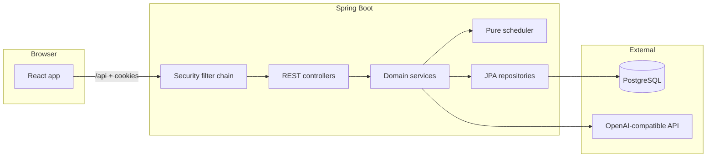
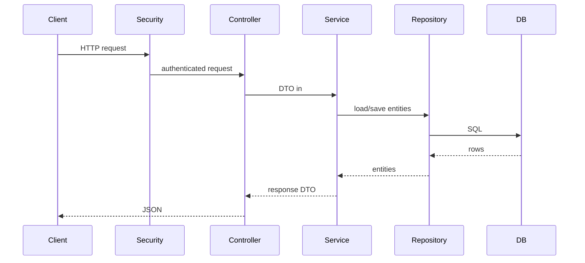
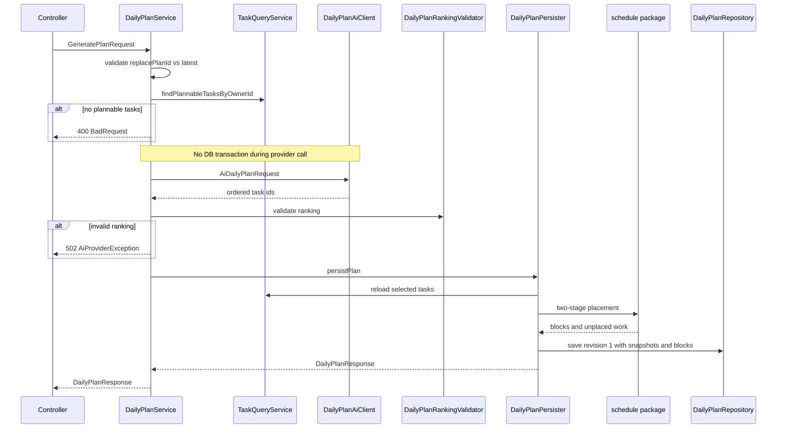
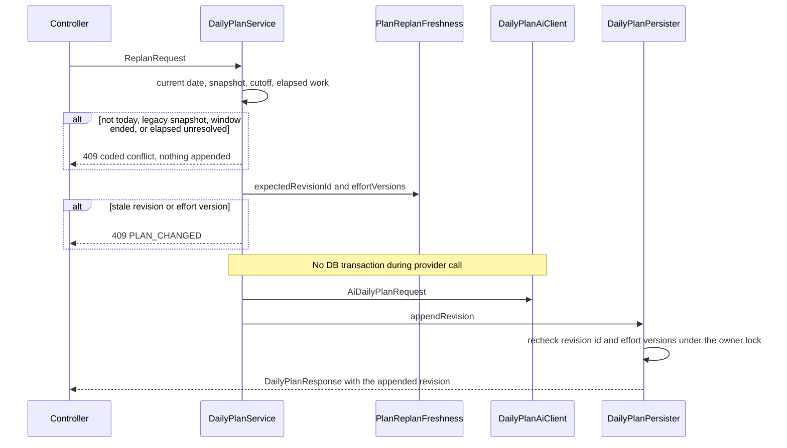
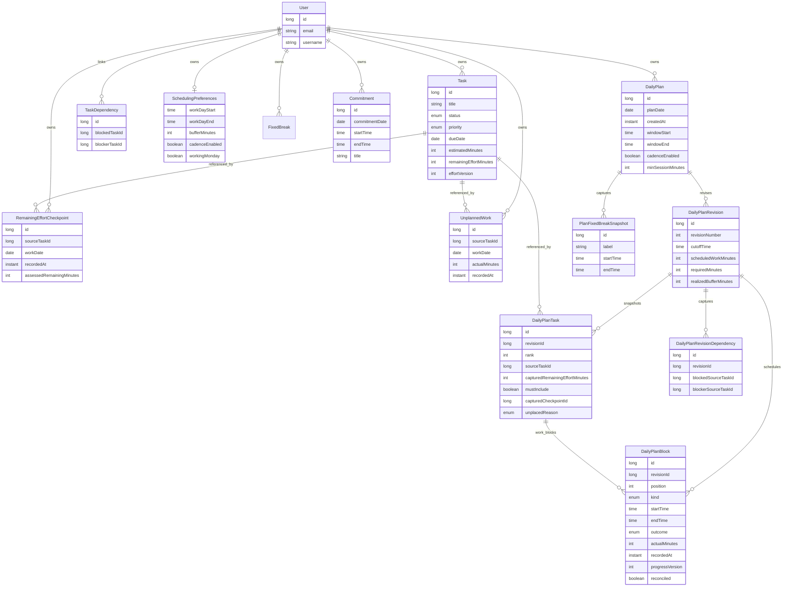

# FocusFlow AI — Architecture

Back to [README](../README.md). API contract: [api.md](api.md).

This document describes how the system is structured, what each backend component does, and how those components work together. For endpoint-level detail, see the [API reference](api.md).

## System overview

FocusFlow AI is a session-based full-stack app:

- **Backend** — Spring Boot (Java 21), JPA/Hibernate, PostgreSQL, Flyway migrations. Exposes a JSON REST API under `/api`.
- **Frontend** — React, TypeScript, Vite. Talks to the backend through a dev proxy with cookie credentials and CSRF headers.
- **External AI** — OpenAI-compatible HTTP API for daily-plan ranking (configurable via env vars).
- **Pure scheduler** — `com.focusflow.schedule` places AI-ranked tasks into minute-aligned blocks using preferences, commitments, and cadence rules, placing each task's captured remaining effort rather than its whole-task estimate. A dependent whose active blocker is not fully placed is left unplaced as `BLOCKED`.
- **Pure effort ledger** — `com.focusflow.effort` folds recorded outcomes and checkpoints into a task's current remaining effort, with no Spring or JPA.
- **Pure dependency rules** — `com.focusflow.dependency` checks cycles, inherits urgency onto blockers, and repairs order inside ranking groups. It has no Spring, JPA, or HTTP DTOs.
- **Pure horizon forecast** — `com.focusflow.horizon` calculates the next seven working days from live tasks and saved Daily plans. It writes nothing and calls no provider.
- **Plan revisions** — a plan owns one or more revisions. A plan with any recorded outcome is retained and re-planned by appending a revision to the same plan id. Each revision snapshots the dependency links it was planned with.

## Request path

Every HTTP request passes through observability and security filters before reaching a controller:

1. **Request ID filter** — Validates or generates `X-Request-Id`, sets MDC for logging, echoes the header on every response (including **401**/**403**).
2. **Security filter chain** — Session cookie (`JSESSIONID`) checked for protected routes. CSRF validated on `POST`/`PUT`/`DELETE`. Public routes: register/login and detail-free liveness/readiness probes. Unauthenticated requests to protected routes return **401**.
3. **Controller** — Validates request DTOs (`@Valid`), delegates to a service, returns response DTOs. No repository access.
4. **Service** — Business logic and transactions. Resolves the current user via `CurrentUser` → `UserContext`. Owner-scoped reads use `findByOwner_IdAndId` patterns. Generation, commitment mutations, and dependency-link edits take an **owner scheduling lock** (`SELECT … FOR UPDATE` on the user row). `GET /api/horizon` does not.
5. **Repository** — Persistence only. Plan detail reads load task snapshots and blocks; list/history uses projection queries that never load block graphs.
6. **Exception handling** — `GlobalExceptionHandler` maps domain exceptions to `ApiErrorResponse` JSON (**400**, **404**, **409**, **502**, etc.), including optional `code` and `requestId` from MDC.

## Backend components

### `security` — authentication, CSRF, and probes

| Component | Role |
|-----------|------|
| `SecurityConfig` | Main filter chain: public register/login; session auth elsewhere; cookie CSRF; logout at `POST /api/auth/logout`. Public liveness/readiness actuator probes. Dev-profile chain permits Swagger/OpenAPI paths only. |
| `FocusFlowUserDetailsService` | Loads `User` by username for Spring Security |
| `CsrfCookieFilter` | Ensures `XSRF-TOKEN` cookie is available to clients |
| `CurrentUser` | Reads `SecurityContext`, returns `UserContext` (id, email, username) to services |
| `UserContext` | Internal identity record — not an HTTP DTO |

Services never depend on auth API DTOs; they call `currentUser.getCurrentUser()` for the owner id.

### `common/observability` — request correlation and probes

| Component | Role |
|-----------|------|
| `RequestIdFilter` | Servlet filter (highest precedence): validate/generate `X-Request-Id`, MDC, response header echo |
| `ObservabilityConfig` | Registers `RequestIdFilter` before Spring Security |
| Actuator (config) | Exposes health (with liveness/readiness groups) and metrics; aggregate health and metrics require a session |

Micrometer counters/timers in `OpenAiDailyPlanClient` and `DailyPlanRankingValidator` record bounded provider and ranking-rejection tags.

### Schema and migrations — Flyway

| Component | Role |
|-----------|------|
| `db/migration/V1__baseline.sql` | Canonical PostgreSQL schema (users, tasks, legacy plan tables) |
| `db/migration/V2__scheduling_foundations.sql` | Preferences, fixed breaks, commitments, task estimate constraint |
| `db/migration/V3__scheduled_day.sql` | Destructive plan reshape: task snapshots, scheduled blocks, drops pre-1.2.0 plan rows |
| `db/migration/V4__scheduled_day_block_constraints.sql` | Block interval and ordering constraints |
| `db/migration/V5__progress_and_revisions.sql` | Forward-only: adds task remaining effort and `effort_version`, backs a plan's metrics into revision 1, moves tasks and blocks onto revisions, captures cadence and fixed breaks, and adds checkpoints and unplanned work. Deletes no plans and invents no scheduling snapshot |
| `db/migration/V6__done_task_zero_remaining.sql` | Allows a `DONE` task to store a zero remainder. Unfinished tasks stay positive or unknown |
| `db/migration/V7__dependencies_and_horizon.sql` | Forward-only: task dependency links, a revision dependency snapshot, `captured_checkpoint_id` on plan tasks, and weekday flags on preferences. Deletes no rows |
| Flyway auto-config | Applies migrations at startup; `ddl-auto: none` in default profile |
| `LegacySchemaAdoptionCommand` | One-shot operator command: preflight existing DB, baseline at V1 (see README) |

Integration tests use the same Testcontainers Postgres fixture and Flyway migrations; Hibernate `validate` in the test profile checks entity/schema agreement.

### `user` — accounts and scheduling lock

| Component | Role |
|-----------|------|
| `User` | JPA entity: email, username, password hash |
| `UserRepository` | Lookup by email/username/id; `findByIdForUpdate` for pessimistic lock |
| `OwnerSchedulingLock` | `lockCurrentOwner()` inside an existing transaction — serializes generate, delete, commitment writes, and dependency-link edits per owner |

Used by `AuthService` (registration), `CurrentUser` (session resolution), and scheduling mutations.

### `auth` — registration and login API

| Component | Role |
|-----------|------|
| `AuthController` | `POST /register`, `POST /login`, `GET /me` |
| `AuthService` | BCrypt hashing, duplicate checks, `AuthenticationManager` login, maps to `UserResponse` |

Register and login both establish a server session (`JSESSIONID`).

### `task` — task CRUD and query facade

| Component | Role |
|-----------|------|
| `TaskController` | CRUD under `/api/tasks`, plus `POST /api/tasks/{id}/remaining-effort` and blocker add/remove |
| `TaskService` | Owner-scoped create/list/get/update/delete; defaults `priority` → `MEDIUM`, new tasks → `OPEN`; rejects zero/negative estimates; keeps `remainingEffortMinutes` and monotonic `effortVersion`; records reassessment checkpoints through `recordRemainingEffortCheckpoint` |
| `TaskDependencyService` | Owner-locked `POST /api/tasks/{id}/blockers` and `DELETE /api/tasks/{id}/blockers/{blockerId}`. Rejects `SELF_DEPENDENCY`, `DEPENDENCY_EXISTS`, and `DEPENDENCY_CYCLE`. Link edits do not bump `effortVersion` |
| `TaskDependency` | Owner-scoped finish-to-start row. Deleting a task deletes every link it appears in |
| `TaskQueryService` | **Facade** for cross-feature reads — plannable tasks (`OPEN` + `IN_PROGRESS`), bulk reload by id for persist, `latestCheckpointRecordedAt`, and the owner's dependency links |
| `UnplannedWorkController` / `UnplannedWorkService` | `POST`/`PUT`/`DELETE /api/unplanned-work`; dated off-rail work that credits or delta-adjusts the remainder |
| `RemainingEffortCheckpoint` | Explicit reassessments; a checkpoint replaces the running remainder instead of adding to it |
| `TaskRepository` | Owner-scoped queries |
| `TaskResponseMapper` | Entity → `TaskResponse` DTO |

A new task starts with `remainingEffortMinutes` equal to its estimate, or null when there is no estimate. The whole-task `estimatedMinutes` and the remainder are separate quantities: while a task is still `OPEN` and carries no checkpoint, unplanned work, or recorded block outcome, an estimate edit also moves the remainder; afterwards it does not. Deleting a task detaches live references but keeps snapshots, outcomes, unplanned work, and checkpoints by `sourceTaskId`.

The plan feature reads tasks only through `TaskQueryService`, not `TaskRepository` (enforced by ArchUnit).

### `dependency` — pure link rules

No Spring, JPA, or HTTP DTOs (enforced by ArchUnit). `TaskDependencyService` and plan generation call it; it never calls back.

| Component | Role |
|-----------|------|
| `DependencyCycleCheck` | Whether adding a link would close a cycle, including through Done or Cancelled tasks |
| `InheritedRanking` | Gives a blocker the urgency of the plannable work waiting on it. Urgency passes only through Open and In-progress tasks |
| `DependencyOrderRepair` | After ranking validation, reorders ids so blockers precede dependents without crossing ranking groups |
| `BrokenDependencyOrderException` | A repair that would move a later group ahead of an earlier one. The horizon read maps it to **500** with the exception message and no partial forecast |

A Done or Cancelled blocker keeps its link and releases the dependent. Link edits do not mark a saved plan as needing refresh. A revision stores the direct links whose blocker and blocked task were both in that revision's candidate set. A revision migrated from before V7 has no dependency rows, which means it was planned with no dependencies.

### `preferences` — scheduling preferences

| Component | Role |
|-----------|------|
| `SchedulingPreferencesController` | `GET`/`PUT /api/scheduling-preferences` |
| `SchedulingPreferencesService` | Effective GET (saved row or in-code defaults), validating PUT with full fixed-break replacement |
| `SchedulingPreferenceDefaults` | Spec defaults when the user has never saved |
| `SchedulingPreferencesValidator` | Work window, peak band, cadence fields, fixed-break overlap, minute alignment |
| `SchedulingPreferences` / `FixedBreak` | One aggregate per owner |

Generating a plan reads effective preferences; saving preferences is explicit via PUT. `workingDays` selects which weekdays the horizon treats as working days. The in-code default is Monday through Friday. An empty set, a duplicate, or an unknown value is **400**.

### `commitment` — dated unavailable windows

| Component | Role |
|-----------|------|
| `CommitmentController` | `GET`/`POST`/`PUT`/`DELETE /api/commitments` |
| `CommitmentService` | Range list, create, update, delete; owner lock; same-date overlap rejection |
| `CommitmentValidator` | Title, time order, minute alignment, overlap |
| `Commitment` | Dated window — not a `Task`; fed into the scheduler as unavailable time |

### `effort` — the remaining-effort ledger

Pure rules: no Spring, JPA, or `plan.dto` dependencies. `plan` and `task` call it; it never calls back.

| Component | Role |
|-----------|------|
| `RemainingEffortCalculator` | `apply(startingRemaining, events) -> EffortAssessment` — folds ordered events into a remainder |
| `EffortEvent` | `WorkCredit(workDate, firstRecordedAt, saveId, outcome, plannedMinutes, actualMinutes)` or `Checkpoint(workDate, firstRecordedAt, saveId, assessedRemainingMinutes)` |
| `EffortAssessment` / `AcceptedEffort` | The assessed remainder, or a rejection when the credit would exhaust it |
| `WorkOutcome` | `DONE`, `PARTLY_DONE`, `SKIPPED` |

Credit rules: `DONE` subtracts the block's planned minutes, `PARTLY_DONE` subtracts the entered positive actual minutes, `SKIPPED` subtracts nothing. A checkpoint replaces the running value, so only later-ordered events credit further. Events order by work date, then first-recorded time, so correcting an event does not change its position. A checkpoint and a credit that share one save do not both apply. Unknown starting effort stays unknown until a checkpoint sets it. Exhausting the remainder to zero or below, without a finish or a positive checkpoint in the same assessment, is rejected and leaves the prior value unchanged.

### `schedule` — pure placement engine

No Spring or JPA dependencies (enforced by ArchUnit). Consumed by plan generation after AI ranking.

| Component | Role |
|-----------|------|
| `FreeIntervalPlanner` | Stage 1: carve free intervals from work window minus commitments and fixed breaks |
| `WorkPlacementPlanner` | Stage 2: place ranked tasks into intervals with cadence breaks and buffer reservation |
| `SchedulePostconditionValidator` | Reject invalid placement output before persist |
| `BlockKind` | `WORK`, `CADENCE_BREAK`, `FIXED_BREAK`, `COMMITMENT`, `BUFFER` |
| `UnplacedReason` | `NO_ESTIMATE`, `OUT_OF_TIME`, `BLOCKED` |

### `plan` — daily plans

| Component | Role |
|-----------|------|
| `DailyPlanController` | Paged summary list, `/by-date` (200/204), get-by-id, delete, generate, block progress, and re-plan under `/api/daily-plans` |
| `DailyPlanService` | Orchestrates generate, list/get/by-date/delete, and re-plan; compare-and-replace and progress preconditions |
| `BlockProgressService` | Records one block's outcome, correction, or crossing reconciliation; writes checkpoints through the `TaskService` facade |
| `DailyPlanRankingValidator` | Reject-not-repair validation of AI ordering; increments Micrometer rejection counter with bounded reason tag |
| `DailyPlanPersister` | Short transactional saves: `persistPlan` writes revision 1; `appendRevision` rechecks revision id and effort versions under the owner lock, then appends |
| `DailyPlanResponseMapper` | Entity → `DailyPlanResponse`; **derives** `warning`, `needsRefresh`, the composed rail, and the day-wide actual counts on read |
| `PlanReplacePreconditions` | Refuses generate and delete of a plan that carries any recorded outcome (**409** `PLAN_HAS_PROGRESS`) |
| `BlockDisplayState` | `ACTIONABLE`, `HISTORICAL`, `SUPERSEDED`, `NO_LONGER_NEEDED` — which blocks still accept a new outcome |
| `DailyPlan` / `DailyPlanRevision` / `DailyPlanTask` / `DailyPlanBlock` | Aggregate: revisions, each holding its ranked task snapshots and ordered scheduled blocks |
| `DailyPlanRepository` | Owner-scoped reads: projection queries for paged summaries; detail loads revisions with their tasks and blocks |

**Summary vs detail:** History list endpoints return `DailyPlanSummaryResponse` via repository projections (`scheduledWorkMinutes`, `workSessionCount`, `scheduledTaskCount`, `unplacedWorkCount`, `hasWarning`, `hasProgress`, `needsRefresh`) without loading blocks. Detail, generate, by-date, and re-plan load the full graph for `DailyPlanResponse`, whose top-level metrics and `blocks` come from the latest revision.

**Generate flow** (the main orchestration):

Steps in code:

1. Validate compare-and-replace: existing plan without `replacePlanId` → **409** `PLAN_EXISTS`; stale id → **409** `PLAN_CHANGED`; a latest plan with any recorded outcome → **409** `PLAN_HAS_PROGRESS`.
2. Load plannable tasks (`OPEN`, `IN_PROGRESS`). Empty → **400**; more than 100 → **400** `PLAN_CANDIDATE_LIMIT`.
3. Call `DailyPlanAiClient.generate` **outside** a database transaction.
4. `DailyPlanRankingValidator.validate` — reject invalid AI output; throw `AiProviderException` → **502**, nothing saved. It does not reject a dependency inversion.
5. `DependencyOrderRepair.repair` — put blockers before dependents inside the validated groups. A repair that would cross groups becomes `AiProviderException` → **502**, nothing saved. The horizon read maps the same exception to **500**.
6. `DailyPlanPersister.persistPlan` (transactional, owner-locked): reload tasks, capture each task's current remaining effort and latest checkpoint id on its snapshot, run the scheduler, and save revision 1 with its blocks and dependency snapshot. A dependent whose active blocker is not fully placed is unplaced as `BLOCKED`. Missing task → **409**.
7. Map to `DailyPlanResponse`; `warning` (including `blockedTasks`), `needsRefresh`, the composed rail, and the day-wide actual counts are derived on read, not stored as separate bits. `needsRefresh` stays the effort and plannability check. Dependency edits do not set it.

**Recording progress:** `BlockProgressService.record` validates the input, checks `expectedProgressVersion`, then derives `BlockDisplayState` from `isSuperseded` (an older-revision block at or after the latest cutoff) and `isNoLongerNeeded` (an unused session of a finished or cancelled task). Only `ACTIONABLE` and `HISTORICAL` blocks are recordable. The branch order is finish, crossing, checkpoint, correction, provisional credit, so a save that both reconciles a crossing block and finishes it is a finish. A provisional credit folds through `RemainingEffortCalculator`; a rejection leaves the prior remainder. `DONE` and `PARTLY_DONE` put the task `IN_PROGRESS`.

**Re-plan flow:**

`ReplanWindow` clamps a cutoff before the window start up to that start and rejects one at or after the window end. `ElapsedWorkRules` names the elapsed blocks that must be resolved first and the superseded future blocks. `ComposedDay` builds the non-overlapping rail: elapsed history through the cutoff, the elapsed portion of a reconciled crossing block, then the latest revision from the cutoff forward. Commitments are reloaded; the captured cadence, minimum session, buffer, and fixed breaks are reused; and the focus stretch restarts without storing a break that was taken. Any failure leaves the previous revision actionable, and a reconciliation saved earlier stays saved.

**By date:** `GET /api/daily-plans/by-date?planDate=...` returns the newest plan for that calendar date, or **204** when none exists.

**Delete** removes the plan, its revisions, task snapshots, and blocks; referenced live tasks remain. A plan that has recorded progress refuses deletion with **409** `PLAN_HAS_PROGRESS`.

### `horizon` — forecast read

`com.focusflow.horizon` is pure: no Spring, JPA, or HTTP DTOs (enforced by ArchUnit). `HorizonForecaster.forecast` takes a `HorizonInput` and returns a `HorizonForecast`. Saved days stay saved. Eligible unrecorded sessions are assumed completed as planned; a session before an active blocker is satisfied, or on or before a checkpoint its revision did not capture, gets no assumed credit. Other working days are forecast with the same inherited order, dependency repair, and scheduler. The forecaster writes nothing and calls no provider.

| Component | Role |
|-----------|------|
| `HorizonController` | `GET /api/horizon?currentDate=&currentTime=` |
| `HorizonService` | One read-only `REPEATABLE_READ` snapshot of tasks, checkpoints, links, preferences, commitments, and saved plans. Does **not** take the owner lock. Maps the forecast to `HorizonResponse` |
| `HorizonForecaster` | Pure seven-working-day forecast. A non-working day appears only when it already has a saved plan, and that column does not consume one of the seven |

Missing or unaligned query parameters are **400**. A repair that crosses ranking groups is **500** with the invariant message. Generate, re-plan, and progress writes are not blocked by a horizon read.

### `ai` — provider boundary

| Component | Role |
|-----------|------|
| `DailyPlanAiClient` | Interface — mockable in tests |
| `OpenAiDailyPlanClient` | OpenAI-compatible HTTP implementation with bounded retry/timeouts and Micrometer timers/counters |
| `DailyPlanPromptBuilder` | Prompt text with task lines, status, ranking rules |
| `AiProviderException` | Provider/validation failures → **502** via `GlobalExceptionHandler` |
| `OpenAiProperties` / `OpenAiClientConfiguration` | Env-driven model, base URL, API key |

The plan service depends on the interface, not the HTTP client directly.

### `common/error` — API error contract

| Component | Role |
|-----------|------|
| `GlobalExceptionHandler` | Maps exceptions to `ApiErrorResponse` |
| `BadRequestException` | **400** (optional `code`, e.g. `PLAN_CANDIDATE_LIMIT`, `REMAINDER_UNRESOLVED`, `FUTURE_ACTUAL`, `BLOCK_NOT_RECORDABLE`) |
| `NotFoundException` | **404** (missing or not owned) |
| `ConflictException` | **409** (optional `code`, e.g. `PLAN_EXISTS`, `PLAN_CHANGED`, `PLAN_HAS_PROGRESS`, `PROGRESS_CONFLICT`, `ELAPSED_WORK_UNRESOLVED`, `REPLAN_LEGACY_SNAPSHOT`, `REPLAN_NOT_TODAY`, `REPLAN_WINDOW_ENDED`) |
| `ForbiddenOperationException` | **403** |
| `ApiErrorResponse` | Shared JSON error shape (`code`, optional `requestId`) |

## Data model

- **Owner scoping** — Tasks, dependency links, plans, preferences, commitments, checkpoints, and unplanned work are always filtered by `owner_id`. Foreign ids return **404**, not **403**.
- **Dependencies** — `TaskDependency` is a unique owner-scoped pair. Deleting a task cascades the links it appears in. `DailyPlanRevisionDependency` freezes the direct links used for that revision and is not rewritten by later link edits. `capturedCheckpointId` records the latest checkpoint the revision saw; null means none.
- **Revisions** — A plan owns one or more revisions. V5 backfills every pre-existing plan into revision 1 and moves the schedule metrics (`free_minutes`, `scheduled_work_minutes`, `required_minutes`, and the buffer columns) off `daily_plans` onto `daily_plan_revisions`. Tasks and blocks hang off the revision, not the plan. Append-only: re-planning adds a revision, and the latest one is the only actionable schedule.
- **Task snapshots** — `DailyPlanTask` freezes title, priority, status, due date, estimate, and `capturedRemainingEffortMinutes` at generate time. Work blocks point at the snapshot; live task edits afterward do not rewrite history.
- **Remaining effort** — `Task.remainingEffortMinutes` is the quantity the scheduler places, kept separate from `estimatedMinutes`; null means unknown. `effortVersion` increments on every change and backs the progress and re-plan conflict checks. `RemainingEffortCheckpoint` stores explicit reassessments, and `UnplannedWork` stores dated off-rail work; both reference the source task by id and survive its deletion.
- **Scheduled blocks** — Minute-aligned intervals (`WORK`, breaks, commitments, buffer) ordered by `position`, carrying the optional outcome, actual minutes, reconciliation marker, and `progressVersion`.
- **Warning and freshness** — `warning`, `needsRefresh`, the composed rail, and the day-wide actual counts are derived on read; none is a persisted JSON snapshot column.
- **Migrated plans** keep a null scheduling snapshot and therefore report `needsRefresh`-independent re-plan refusal with `REPLAN_LEGACY_SNAPSHOT`; they never get fabricated current preferences.

## Frontend structure

The React app mirrors backend feature boundaries:

| Area | Location | Role |
|------|----------|------|
| HTTP client | `frontend/src/lib/api.ts` | `fetch` with `credentials: 'include'`, CSRF header on mutations |
| Types | `frontend/src/types/api.ts` | Mirrors backend DTOs |
| Auth | `features/auth/` | Login/register forms, session hooks |
| Tasks | `features/tasks/` | List, form, actions, and the remaining-effort reassessment control |
| Preferences | `features/preferences/` | Settings form, GET/PUT helpers, effective-defaults copy |
| Commitments | `features/commitments/` | Dated window CRUD for the planning date |
| Plans | `features/plans/` | Generate/re-plan card, `DailyPlanView` with the composed rail, `BlockProgressDialog`, `UnplannedWorkForm`, `RevisionSelect`, `DayTimeline` rail, history badges, derived warning, delete |
| Horizon | `features/horizon/` | `/horizon` grid from `GET /api/horizon`, plus deadline badges on the task list. The query key is the current date and minute |
| Routes | `App.tsx` | Dashboard (URL-backed `planDate`), plan detail/history, `/horizon` between Plans and Settings, `/settings`, login/register |

Vite proxies `/api` to `:8080` in development so session cookies stay same-site from the browser’s perspective (`localhost:5173`).

TanStack Query hooks in each feature invalidate cache keys after mutations (e.g. plan delete refreshes list and the by-date query for the active day). A progress save, an unplanned-work change, or a re-plan invalidates the by-date plan, the plan list, the plan detail, and the task list, and a `PROGRESS_CONFLICT` or `PLAN_CHANGED` response triggers the same refetch instead of overwriting the newer server state. Task, dependency, preference, commitment, progress, generate, and re-plan mutations also invalidate the horizon query. The horizon page refetches on each visible minute and when the page becomes visible again. A failed horizon request leaves task actions available. The dashboard and plan detail share one outcome dialog; only the detail page offers revision selection.

## Layering checklist (contributors)

- Controllers delegate to services only; never inject repositories.
- Services own business logic and transactions; repositories handle persistence only.
- Cross-feature reads go through facades (e.g. `TaskQueryService`), not another feature's repository.
- `com.focusflow.schedule`, `com.focusflow.effort`, `com.focusflow.dependency`, and `com.focusflow.horizon` stay free of Spring, JPA, and HTTP DTOs.
- Security exposes `UserContext`, not auth API DTOs, to other layers.
- Architecture rules are enforced by `LayeredArchitectureTest` (ArchUnit) in `backend` tests.

## Java and Spring learning map

Open these packages in roughly this order to trace a request from HTTP to persistence and back:

- **`auth`** — `AuthController` and `AuthService` show registration, login, the Spring Security authentication manager, BCrypt password hashing, and clear duplicate-email/username conflicts.
- **`security`** — `SecurityConfig`, `CsrfCookieFilter`, `CurrentUser`, and `UserContext` teach filter-chain configuration, cookie-based CSRF, a **401** authentication entry point, session logout, and how application code receives the current user without depending on auth API DTOs.
- **`user`** — `User`, `UserRepository`, and `OwnerSchedulingLock` are the account entity, repository, and pessimistic lock used to serialize scheduling mutations per owner.
- **`task`** — `TaskController`, `TaskService`, `TaskDependencyService`, `TaskQueryService`, and `TaskRepository` teach owner-scoped CRUD, transactions, mapping, and a small query facade. `TaskService` also owns the remaining-effort and checkpoint rules, and `UnplannedWorkService` shows off-rail work crediting the same ledger. `TaskQueryService` lets the plan feature read tasks and links without coupling directly to another feature's repository.
- **`dependency`** — `DependencyCycleCheck`, `InheritedRanking`, and `DependencyOrderRepair` are pure Java. Read them to see why a blocker inherits urgency and why order is repaired after ranking validation.
- **`preferences`** — `SchedulingPreferencesController`, `SchedulingPreferencesService`, and `SchedulingPreferenceDefaults` show effective reads versus explicit saves, validation, and full aggregate replacement for fixed breaks.
- **`commitment`** — `CommitmentController` and `CommitmentService` show dated unavailable windows, overlap rejection, and owner locking alongside plan generation.
- **`effort`** — `RemainingEffortCalculator` and `EffortEvent` are pure Java: fold ordered credits and checkpoints into a remainder, with no Spring or JPA. Read it first to understand why `DONE`, `PARTLY_DONE`, and `SKIPPED` credit differently.
- **`schedule`** — `FreeIntervalPlanner`, `WorkPlacementPlanner`, and `SchedulePostconditionValidator` are pure Java: no Spring beans, easy to unit test, and invoked from `DailyPlanPersister` after AI ranking. `ReplanWindow`, `ElapsedWorkRules`, and `ComposedDay` add the re-plan cutoff, elapsed-work classification, and the composed rail.
- **`plan`** — `DailyPlanController`, `DailyPlanService`, `DailyPlanRevision`, `DailyPlanTask`, `DailyPlanBlock`, and `DailyPlanRepository` show orchestration, revision-preserving persistence, scheduled blocks, owner-scoped reads, compare-and-replace generation, and re-planning. `BlockProgressService` shows outcome recording, corrections, and crossing reconciliation. `DailyPlanResponseMapper` derives warnings, freshness, and the composed rail on read. `HorizonService` shows the snapshot read that does not take the owner lock.
- **`horizon`** — `HorizonForecaster` and `HorizonInput` are pure Java. `HorizonController` is the HTTP edge. The forecast does not create a revision.
- **`ai`** — `DailyPlanAiClient` is the mockable provider boundary; `OpenAiDailyPlanClient` is the OpenAI-compatible implementation. Follow `DailyPlanPromptBuilder` to see structured prompt construction and `AiProviderException` to see provider failures become **502** responses.
- **`common/error`** — `GlobalExceptionHandler` and the exception types define the API error contract: validation or domain preconditions **400**, unauthenticated **401**, missing owner-scoped data **404**, coded conflicts **409**, and AI-provider failures **502**.
- **Repositories and JPA fetching** — Compare owner-id repository methods. `DailyPlanRepository` uses projections for history and loads task/block graphs for detail while `open-in-view` is disabled.
- **DTOs and validation** — Request/response records under each feature's `dto` package separate the HTTP contract from JPA entities.
- **Tests** — Mockito service tests isolate business behavior; `@WebMvcTest` controller tests exercise JSON, validation, and security boundaries; `PostgresIntegrationTest` uses Testcontainers for real PostgreSQL behavior; `LayeredArchitectureTest` uses ArchUnit to enforce dependency rules.

The frontend is the practical counterpart: Vite proxies `/api`, `frontend/src/lib/api.ts` uses `credentials: 'include'`, and it reads the CSRF cookie to attach the matching header for mutating requests. `DayTimeline.tsx` renders the scheduled block rail; the dashboard loads plans via `/by-date` with a URL-backed planning date.
